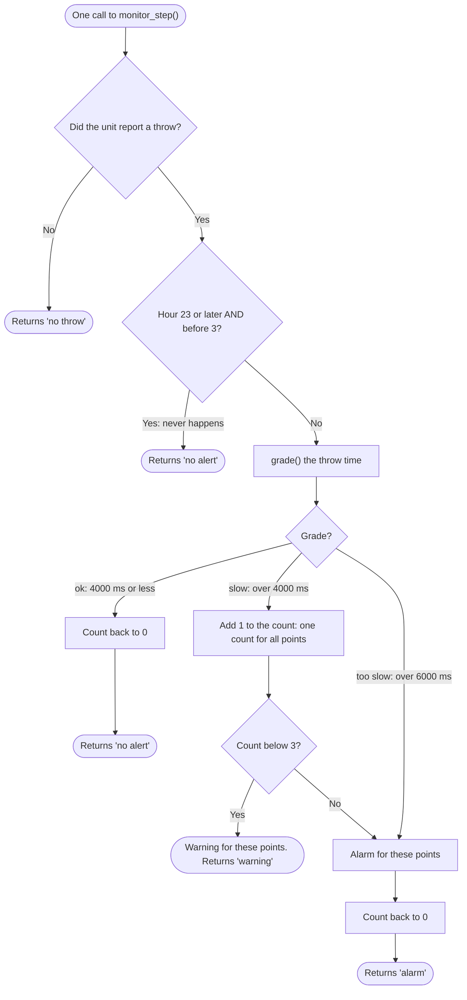

# How the monitor works (reference)

This is one possible result of reverse engineering [monitor.c](../../../point-monitor/monitor.c) in Step 1: what one call to `monitor_step()` does today, and where that differs from what maintenance expects.

## One monitor step

## Today against what maintenance expects

| Rule from maintenance | What the code does today | Verdict |
| --------------------- | ------------------------ | ------- |
| A throw over 4 seconds is slow: warning | `grade()` returns slow above 4000 ms; the monitor sends a warning | Matches |
| A throw over 6 seconds is too slow: alarm | `grade()` returns too slow above 6000 ms; the monitor sends an alarm | Matches |
| Three slow throws in a row on the same points: alarm | One counter for all points: slow throws on different points add up, and a normal throw on any points resets it | Defect: false alarms and missed alarms |
| No alerts from 23:00 to 03:00 | The check `h >= 23 && h < 3` is never true, because the window crosses midnight | Defect: alerts all night |
| Not stated | After an alarm the count restarts | Question for maintenance |

## What the program output shows

`monitor_app` replays eight throws. P105 moves once, in 4800 ms, yet gets an alarm: P103 and P104 were slow just before it, so the shared count reaches 3 on P105.

## Related

- [Review findings](review.md)
- [Monitor spec](monitor.spec.md)
- [Reference solution](README.md)
